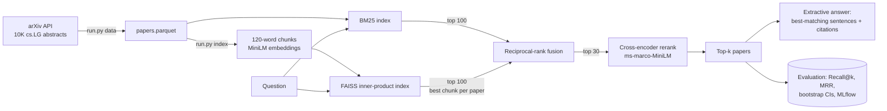

# Research-Paper Q&A with Retrieval Evaluation

**Ask a question about recent machine-learning research and get an answer built from verbatim,
cited sentences from 10,000 arXiv abstracts. Four retrieval methods were measured on 500 queries
to find out which one actually works best.**

> **Live demo:** https://arxiv-ml-research.streamlit.app (free tier: if it's asleep, click
> "wake up"; the first question takes ~1 min while models load) · Run it locally: `python run.py app`

## Results at a glance

Known-item evaluation on 500 queries (details below). Higher is better:

| Retriever | Recall@1 | Recall@5 | MRR@10 | Latency / query* |
|---|---|---|---|---|
| BM25 keyword search (baseline) | 0.858 | 0.944 | 0.892 | 28 ms |
| Dense: MiniLM embeddings + FAISS | 0.774 | 0.896 | 0.827 | 30 ms |
| Hybrid: BM25 + dense, reciprocal-rank fusion | 0.872 | 0.958 | 0.909 | 68 ms |
| **Hybrid + cross-encoder rerank** | **0.932** | **0.974** | **0.950** | 6.2 s |

**Hybrid + rerank beats the BM25 baseline by +7.4 points Recall@1** (95% paired-bootstrap CI:
+4.2 to +10.6) **and +5.7 points MRR@10** (CI: +3.5 to +8.0). It misses the right paper in the
top 10 for 9 queries, vs. 22 for BM25.

\*Measured on a laptop CPU, including model inference. Reranking 30 candidates with a cross-encoder
is about 90× slower than hybrid search. That's the price of its accuracy.

## Why this matters

Retrieval-augmented generation (RAG) is only as good as its retrieval. If the right document never
reaches the answer step, no language model can fix that. Yet most RAG demos pick a vector database
and never measure whether it beats plain keyword search. This project **measures it**: four
retrieval configurations on the same queries, with confidence intervals, and an answer step that
can't make things up because it only quotes the sources it cites.

## Data

- **10,000 most recent `cs.LG` arXiv papers** (submitted 2026-09-12 to 2026-10-27): title,
  abstract, authors, date, and categories. 58% are primary `cs.LG`; the rest are cross-listed.
- Fetched from the official [arXiv API](https://info.arxiv.org/help/api/index.html) with
  `python run.py data`: 10 requests, rate-limited to 1 every 3 seconds per arXiv's terms.
- **License:** the [arXiv API Terms of Use](https://info.arxiv.org/help/api/tou.html) place
  descriptive metadata (titles, abstracts, authors) under **CC0**. Only abstracts are used, never
  PDFs or full text. The cleaned corpus and its embeddings are committed in `artifacts/`
  (27 MB), so the demo runs without re-fetching.
- Abstracts have a median of 195 words, which is longer than MiniLM's 256-token input. Each one is
  split into overlapping 120-word chunks (30-word overlap), giving 23,268 chunks.

Thank you to arXiv for use of its open access interoperability.

## Approach



1. **BM25** (`rank-bm25`): keyword matching with term-frequency saturation and length normalization.
2. **Dense:** `all-MiniLM-L6-v2` sentence embeddings with exact cosine search in FAISS. A paper's
   score is its best-matching chunk.
3. **Hybrid:** reciprocal-rank fusion, `score = Σ 1/(60 + rank)`. It combines the two rankings
   without having to calibrate BM25 scores against cosine similarities.
4. **Rerank:** `cross-encoder/ms-marco-MiniLM-L-6-v2` reads the question and each of the top 30
   hybrid candidates *together* and rescores them.
5. **Extractive answer:** the sentences from the top papers that are most similar to the question
   (at most 2 per paper, 4 in total), each tagged with its source number. **No text is
   generated**, so every sentence can be traced to a cited paper.

### How the evaluation works

Real questions need human relevance labels, which take a lot of time to collect. Instead this uses
**known-item search**, a standard proxy:
- 500 papers are sampled with a fixed seed.
- Each paper's **title is the query**, and the one correct answer is **that paper**.
- **Titles are deliberately not indexed** (only abstracts), so the task isn't trivial.
- Metrics are Recall@1/5/10 and MRR@10.
- Differences are tested with a **paired bootstrap** (10,000 resamples of the same queries).
- Queries are also split by how many of the title's words appear in its abstract, to see where
  each method helps.

## Full results

| retriever | Recall@1 | Recall@5 | Recall@10 | MRR@10 | Recall@5, low word overlap (n=237) | Recall@5, high overlap (n=263) |
|---|---|---|---|---|---|---|
| BM25 | 0.858 | 0.944 | 0.956 | 0.892 | 0.882 | 1.000 |
| Dense | 0.774 | 0.896 | 0.930 | 0.827 | 0.823 | 0.962 |
| Hybrid RRF | 0.872 | 0.958 | 0.966 | 0.909 | 0.911 | 1.000 |
| **Hybrid + rerank** | **0.932** | **0.974** | **0.982** | **0.950** | **0.945** | 1.000 |

Paired bootstrap vs. BM25 (`reports/significance.csv`):

| system | metric | Δ vs. BM25 | 95% CI | significant? |
|---|---|---|---|---|
| Dense | Recall@1 | −0.084 | [−0.122, −0.046] | yes (worse) |
| Hybrid RRF | Recall@1 | +0.014 | [−0.014, +0.042] | **no** |
| Hybrid + rerank | Recall@1 | **+0.074** | [+0.042, +0.106] | **yes** |
| Hybrid + rerank | MRR@10 | **+0.057** | [+0.035, +0.080] | **yes** |

## Key insights

1. **Keyword search is a strong baseline, and embeddings alone lost to it.** Titles share many words
   with their abstracts (median 78% of title words reappear), which is exactly what BM25 rewards.
   Dense retrieval was *significantly worse* (−8.4 points Recall@1). Swapping in a vector database
   doesn't automatically improve search.
2. **Fusion helps where keywords fail, but only a little.** Hybrid RRF raised Recall@5 on
   low-overlap queries from 0.882 to 0.911, but its overall gain over BM25 is within noise. It's
   cheap (68 ms) and never hurt on high-overlap queries.
3. **The cross-encoder is where the real gain is.** Reading the question and the abstract together
   lifted Recall@1 by 7.4 points (significant) and cut top-10 misses from 22 to 9. The cost is
   about 90× the latency on CPU, so in production you'd rerank only a small candidate set (as done
   here) or use a GPU.
4. **Measure before choosing.** Without the evaluation, the "obvious" choice (vector search) would
   have been the worst of the four.

## Limitations

- **Known-item search is a proxy.** Title→abstract matching is easier and more keyword-heavy than
  real questions such as "which methods work for non-IID clients?". The ranking of methods could
  differ on real questions. A small hand-labeled question set would be the next step.
- **The embedding model was trained on a similar task.** `all-MiniLM-L6-v2` was trained partly on
  title–abstract pairs from older papers. The corpus here postdates the model, so specific papers
  can't have been memorized, but the task type is familiar to it.
- **Extractive answers can be generic.** Picking sentences by similarity favors definition-style
  opening sentences (e.g. "Federated learning trains a shared model...") over specific findings.
  A generative step (optional, free open model) or a sentence-position penalty could help.
- **Snapshot:** 6 weeks of `cs.LG` only. Run `python run.py data` again to refresh.
- **Latency:** reranking takes about 6 seconds per query on this laptop CPU. Hosted CPUs vary.

## Next steps

- 30–50 hand-written questions with labeled relevant papers, for a realistic second benchmark.
- An optional generative answer with a small free model, plus a faithfulness check (every answer
  sentence must be supported by a cited abstract).
- Topic map of the corpus (clustering + 2D projection) in the app.
- Tune the RRF constant and rerank depth on a validation split, not the test queries.

## How to run

Requires Python 3.12.

```bash
python -m venv .venv
```
```bash
.venv/Scripts/python -m pip install -r requirements.txt    # macOS/Linux: .venv/bin/python
```
```bash
.venv/Scripts/python run.py app     # demo using the committed artifacts (downloads ~180 MB of models on first run)
```
```bash
.venv/Scripts/python run.py test    # ruff + pytest (23 tests, no model downloads)
```
```bash
.venv/Scripts/python run.py all     # re-fetch data, re-embed (~35 min on CPU), re-evaluate (~50 min on CPU)
```

`make data | index | eval | test | app | all` does the same on macOS/Linux. Models are cached in the
project's `.hf_cache/` folder. To browse experiment runs, run
`mlflow ui --backend-store-uri sqlite:///mlflow.db`.

## Project structure

```
src/paperqa/
  config.py        paths, arXiv settings, model names, retrieval defaults
  ingest.py        rate-limited arXiv API client + Atom parser
  text.py          cleaning, BM25 tokenizer, chunking, sentence splitting
  retrievers.py    BM25, dense (FAISS), hybrid RRF, cross-encoder rerank
  index.py         build/load embeddings and retrievers
  evaluate.py      known-item evaluation, overlap buckets, MLflow logging
  significance.py  paired bootstrap confidence intervals
  answer.py        extractive, cited answers
app/streamlit_app.py   question box, method switch, cited answer + sources
tests/                 23 unit tests with small fake encoders (no downloads in CI)
artifacts/             papers.parquet, chunk embeddings (CC0 metadata)
reports/               results, per-query ranks, significance
```

## Tech stack

Python 3.12 · sentence-transformers · PyTorch · FAISS · rank-bm25 · pandas · MLflow · Streamlit ·
pytest · ruff · GitHub Actions

## License

Code: MIT. Paper metadata: CC0 via the arXiv API. Copyright in the papers remains with their
authors.
